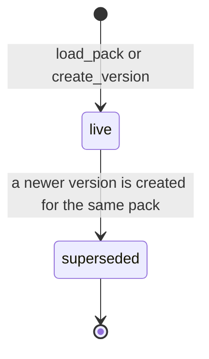

# Functional Specification — u1-knowledge-graph

Upstream: `unit-of-work.md` (U1), `unit-of-work-story-map.md`, `stories.md` (this unit implements part of US3.2, US3.6, US8.2 and US9.1), `requirements.md` (FR1, FR2, FR3), `components.md` (KnowledgeGraph), `contract-summary.md` (C1). Source of truth for data: `entities.md`; for rules: `rules.md`.

## Purpose

U1 is a library that holds versioned clinical knowledge and answers searches and traversals on a pinned version. It also ships the content: the IBD pack v1.0 and the urology stub. It has no screens and calls no other unit.

## Workflows

### W1 — Load a pack (load_pack)

1. Read the pack file (format decided in Code Generation: YAML or JSON, contract open question C1).
2. Parse sources, nodes and edges.
3. Validate: every node has at least one known source (BR1.1); edges are well-formed (BR1.2); each node type has its required fields (BR1.4); no placeholders remain (BR3.5).
4. If any check fails, stop with PackLoadError naming the first offending node or edge, and store nothing.
5. If the pack already exists, the file's version number must be higher than the live one, or the load is refused with VersionNotIncreasing (BR1.3).
6. Otherwise, in one transaction, store the pack (if new) and a PackVersion: number from the file, status live, publishedBy the builder's system profile ID, and changeSummary from the file ("Initial load" for a first load). Supersede the previous live version, if any.
7. Return the PackVersionRef.

### W2 — Search and traverse (search, neighbours, get_node)

1. The caller names a version (BR1.5) and passes the case's facts: confirmed findings and test results, as Fact records.
2. `search(version, facts)` matches facts to entry nodes by name or synonym and by converted metric value (BR2.1). Facts with a unit outside the conversion table come back as `unknown_unit`. An empty match list means there is no grounded entry point.
3. `neighbours(version, nodeId, facts, relation?)` returns every outgoing edge as a Step with status followable, not_taken, alternative or unknown_input (BR2.2, BR2.3). U4 follows the followable steps, asks for the tests named by unknown_input steps, and shows the rest on the map.
4. `get_node` returns one node with its fields and sources; an unknown ID raises NodeNotFound.

### W3 — Reference range (reference_range)

1. The caller names a metric node and the patient's sex, age and pregnancy status.
2. Return the most specific range, or the widest range with the flag `sex_not_recorded` (BR2.4).

### W4 — Map data (subgraph)

1. Given a version and node IDs, return those nodes with their column and alternative flag, plus the edges among them (BR2.6).

### W5 — Claim matching (match_claims, find_supporting_node)

1. U1 owns claim matching (BR2.5). `match_claims(node, claims)` compares each claim with the node's fields: text after normalisation and synonyms, numbers exactly after unit conversion. It returns the matched claims and the failures with reasons.
2. U4's grounding guard calls `match_claims` for each cited node. For a per-kg dose, U4 first gets the computed absolute dose from U3 and passes it as an absolute claim.
3. `find_supporting_node(version, sourceId, claims)` runs `match_claims` over the nodes citing that source, in nodeId order, and returns the first with no failures, or null. U7 uses it to score the plain run.

### W6 — New version (create_version, called only by U5 on publish)

1. Copy the base version's nodes, edges and the pack's sources.
2. Apply the ChangeSet: addNodes, updateNodes, removeNodeIds, addEdges, removeEdgeIds, addSources, changeSummary.
3. Re-run BR1.1, BR1.2, BR1.4 and BR3.5 on the result.
4. In one transaction, store it as the next minor version (live) and mark the old version superseded (BR1.3).
5. Any failure leaves both versions unchanged.
6. `list_versions(pack)` returns every version, newest first, for U5's version history.

### W7 — Comments

1. `add_comment` stores text under the node's globally unique, pack-prefixed ID with its author's profile ID; `list_comments` returns the newest first (BR2.7). Comments never cross packs.

## Contract Changes Needed (C1, owned by U1)

These change C1 in `contract-summary.md` and are recorded there:

- `search(version, facts: [Fact]) -> {matches: [Node], unknownUnit: [Fact]}`, where `Fact` replaces the undefined `FindingRef`.
- `neighbours(version, nodeId, facts: [Fact], relation?) -> [Step]`, where Step = {edge, node, status: followable|not_taken|alternative|unknown_input}.
- New `match_claims(node, claims) -> {matched, failures}`. U1 owns claim matching; C6's `check_line` uses it.
- New `list_versions(pack) -> [PackVersion]`.
- `create_version(pack, base, changes: ChangeSet, publishedBy)`, with ChangeSet as in entities.md.
- Node and source IDs are pack-prefixed and globally unique, so the comment operations take the plain `nodeId`.

## State Machine — PackVersion



<!-- Text fallback: A version is created live by load_pack or create_version. When a newer version is created for the same pack, the older one becomes superseded. Nothing else ever changes a version. -->

## Content Deliverables

| Pack | Version | Must contain | Rules |
|---|---|---|---|
| IBD | v1.0 | UC branch at full depth; Crohn's branch at the same depth; infectious-colitis alternative; drug, interaction, allergy cross-reactivity and response-criterion nodes for the demo drugs and tiers; reference ranges for Hb by sex and calprotectin | BR3.1, BR3.2, BR3.3, BR3.5 |
| Urology stub | v0.1 | A handful of cited nodes forming one walkable path | BR3.4, BR1.6 |

Content is drafted with Claude and loaded directly (FR2.6). It is paraphrased and cited (FR2.5). Your reviewer checks the IBD content by Oct 31 (external-dependency-map.md).

## Entity Relationships (derived from entities.md)

```mermaid
erDiagram
  Pack ||--o{ PackVersion : has
  PackVersion ||--o{ Node : contains
  PackVersion ||--o{ Edge : contains
  Node }o--o{ Source : cites
  Edge }o--|| Node : from
  Edge }o--|| Node : to
  Node ||--o{ NodeComment : "has (by nodeId)"
```

<!-- Text fallback: A Pack has many PackVersions. Each PackVersion contains many Nodes and Edges. Nodes cite one or more Sources. Each Edge goes from one Node to another. Comments attach to a node by its ID. -->

## Rules Summary (derived from rules.md)

- **Loading is strict:** no source, malformed edges, missing fields or placeholders mean no load (BR1.1, BR1.2, BR1.4, BR3.5).
- **Versions are immutable and every read names one** (BR1.3, BR1.5).
- **Search, traversal and reference ranges** are the walk's only access path (BR2.1–BR2.4); alternatives come back as not-taken (BR2.3).
- **The content** is UC and Crohn's at full depth, plus alternatives, safety and response nodes, plus the urology stub (BR3.1–BR3.4).

## Error Handling

| Error | When | Caller sees |
|---|---|---|
| PackLoadError(nodeId or edgeId, reason) | W1 or W6 validation fails | Load or publish refused; nothing changed |
| VersionNotIncreasing(pack, number) | load_pack with a repeated or lower number | Load refused; nothing changed |
| VersionRequired | A read without a version | Programming error, raised immediately |
| NodeNotFound(nodeId) | Unknown node in a version | Typed error; U4 treats it as out of knowledge |
| Storage error | Database unavailable | Raised to the caller, never swallowed (NFR8) |

## Acceptance Criteria Handled Elsewhere

Parts of US3.2, US3.6 and US8.2 belong to other units: the streamed walk and counts (U4), screens (U8), and proposals and the reviewer (U5). They are listed as N/A in `traceability.json`, with the delivering unit named.
