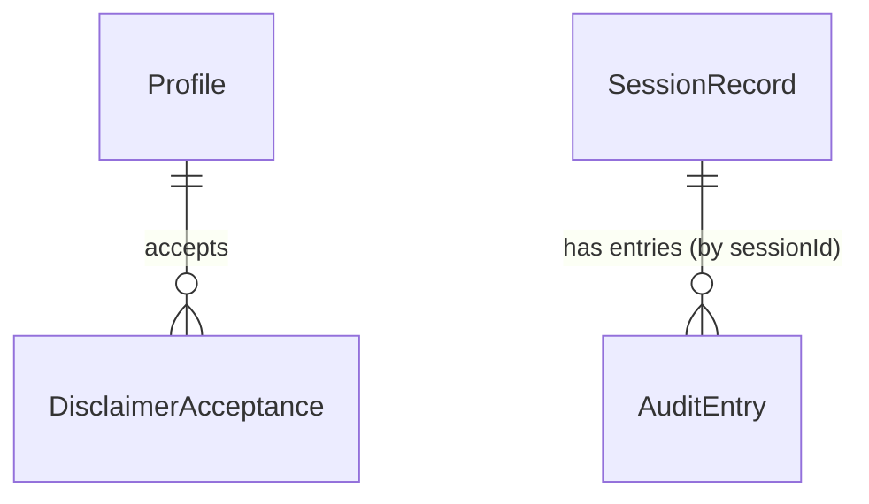

# Functional Specification — u2-platform

Upstream: `unit-of-work.md` (U2), `unit-of-work-story-map.md`, `stories.md` (this unit implements part of US1.1, US1.2, US3.4, US7.1 and US7.2), `requirements.md` (FR9, FR11, FR14, NFR5, NFR7, NFR11), `components.md` (Audit, Identity, ModelGateway), `contract-summary.md` (C2, C3, C4). Data: `entities.md`. Rules: `rules.md`.

## Purpose

U2 is a library of three modules with no dependencies on other units:
- `brahma.platform.audit`: the append-only clinical record, history, export.
- `brahma.platform.identity`: demo profiles, roles, disclaimer.
- `brahma.platform.models`: the model gateway.

## Workflows

### W1 — Append an audit entry (C2.append)
1. Validate the entry: known profile, payload size, kind (BR1.2).
2. Insert it in one transaction (BR1.1) and return the entryId.

### W2 — Record a session (C2.record_session)
1. Validate the record: required profile, pack version, provider and model (BR1.2).
2. In one transaction, insert the SessionRecord and a `session_recorded` AuditEntry pointing to it.

### W3 — History, detail, export
1. `list_sessions(filter)` follows BR1.3 and returns summaries: sessionId, caseId, createdAt, label from the inputs, outcome and pack version.
2. `get_session(id)` returns the record and its audit entries (by sessionId) in time order.
3. `export_session(id, json|pdf)` follows BR1.4.

### W4 — Sign in and disclaimer
1. `list_profiles()` returns the three listed profiles. They are seeded at first start if missing; the seed is idempotent (BR2.1).
2. `needs_disclaimer(profileId)` is checked after sign-in. `accept_disclaimer(...)` stores the acceptance and writes `disclaimer_accepted` to the audit (BR2.2).
3. `require_role(profileId, role)` guards reviewer and system actions (BR2.3).

### W5 — Model call (C4.complete)
1. Read the active ProviderConfig (BR3.1).
2. Take a throttle token, then call the provider with the timeout.
3. On a retryable error, back off and retry, at most twice (BR3.2).
4. Validate structured output when a schema was given (BR3.4).
5. Log the call (BR3.3) and return a ModelResponse with provider, model, latency and tokens, or raise the typed error.

## State Machines

U2's entities have no lifecycle states: audit rows are immutable, and a disclaimer acceptance is a single event.

## Entity Relationships (derived from entities.md)

<!-- Text fallback: A Profile accepts disclaimers. A SessionRecord has audit entries linked by its sessionId. ModelCallLog and ProviderConfig stand alone. -->

## Rules Summary (derived from rules.md)
- **Audit:** append-only and complete (BR1.1, BR1.2), searchable (BR1.3) and exportable (BR1.4).
- **Identity:** pick a profile, accept the disclaimer, check roles (BR2.1–BR2.3).
- **Model gateway:** one configured provider, throttled, at most 2 retries, typed errors, every call logged, structured output validated (BR3.1–BR3.4).

## Error Handling

| Error | When |
|---|---|
| AuditImmutable | An update or delete reaches an audit table |
| AuditInvalid(reason) | Missing profile or field, or oversize payload |
| SessionNotFound | Unknown sessionId |
| ExportFailed | PDF rendering failed; nothing partial returned |
| ProfileNotFound / Forbidden | Unknown profile / wrong role |
| ConfigError | Missing provider setting or key at start |
| ModelTimeout / ModelRateLimited / ModelAuthError / ModelUnavailable | After retries, with provider and retryable flag |

## Acceptance Criteria Handled Elsewhere

These belong to other units and are N/A in `traceability.json`:
- **u8-web-app:** screens, buttons and the "No sessions yet" text.
- **u4-grounded-agent:** filtering the "why" sentences (AC7.1.2), the replay map (AC7.2.2) and the out-of-knowledge answer (AC3.4.1).
