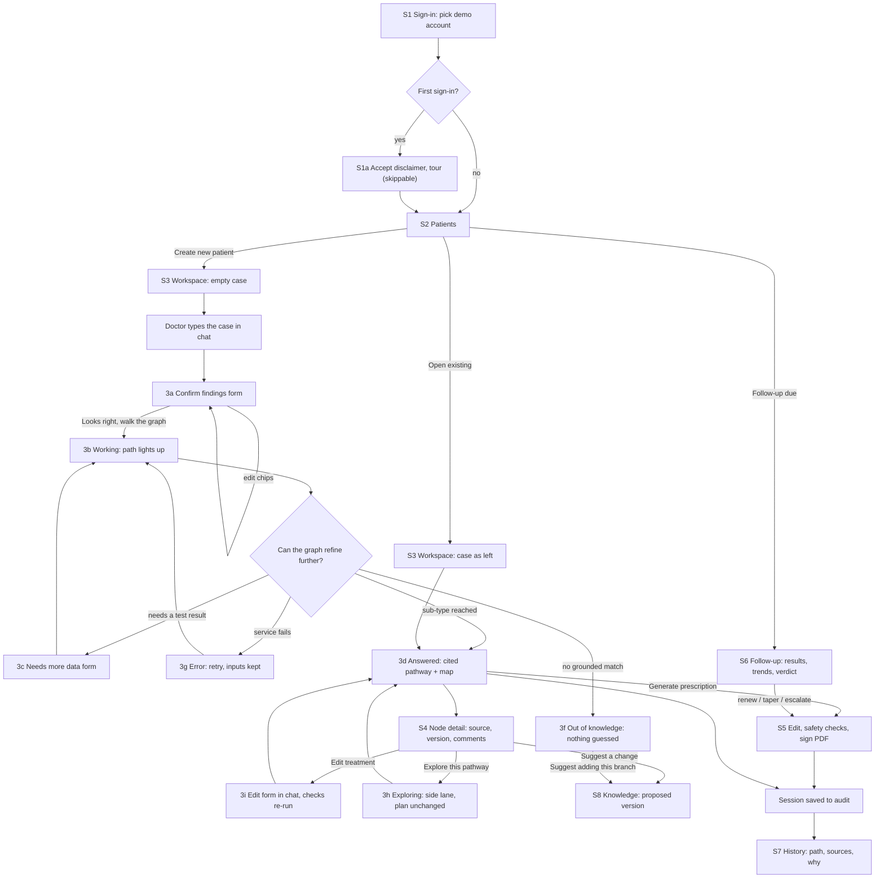

# User Flow — Brahma (Clinical Decision Graph)

Upstream: `intent-statement.md` (the specialist's walk from symptoms to treatment), `scope-document.md` (demo depth: UC and Crohn's to sub-type), `intent-backlog.md` (value stream, IB-01 … IB-13). Screens: `wireframes.md` (S1–S9). Visual source: `docs/design-handover/`.

## Core flow (the demo walk)



<!-- Text fallback: The doctor signs in with a demo account. On first sign-in they accept the disclaimer and may take a short tour, then land on Patients. From Patients they create a new patient or open an existing case. In a new case they describe the patient in the chat; Brahma reads the findings back as an editable form. When the doctor confirms, Brahma walks the graph and the path lights up on the map. If it needs a test result it asks with a form and walks again; if the graph has no grounded match it says so and guesses nothing; if the service fails it offers Retry with inputs kept. When it reaches the sub-type it shows the cited pathway and the map. From any node the doctor can see its source, version and comments, edit a treatment (checks re-run), explore a side pathway without changing the plan, or suggest a knowledge change, which becomes a proposed version. From the answer the doctor can generate, check and sign a prescription. Every session is saved to the audit and shows in History. A follow-up visit asks for new results, plots trends, gives a verdict and leads to renewing, tapering or escalating the prescription. -->

## Happy path in one line

```text
Sign-in -> Patients -> New patient -> describe case -> confirm findings
  -> walk -> needs more data -> enter results -> answered (sub-type, tier)
  -> open node / edit treatment -> generate and sign prescription
  -> session in History -> follow-up visit -> trends and verdict
```

## Side flows

| Flow | Start | End | Screens |
|------|-------|-----|---------|
| Review a past decision | History nav | Session audit detail, optional "Replay on canvas" | S7 |
| Keep knowledge current | Knowledge nav, node panel "Suggest a change", or out-of-knowledge "Suggest adding this branch" | Proposed version v1.x with comment, visible in version history | S8 |
| Show grounding to judges | Benchmark nav | 20 cases, graph vs plain model, pass at ≥ 95% | S9 |
| Second specialty | Sign in as the demo urologist, or a urology case on Patients | Same walk on the urology stub | S2, S3 |
| Update patient details | Card "Edit details" or chat ("she's 62 kg") | Card, reference ranges and weight-based doses update; chat confirms | S3 |

## Rules the flow keeps

- **Grounded or silent:** every answer line links to a node and source; when none fits, the flow ends in "out of knowledge", never a guess (intent-statement.md).
- **Decision support, not diagnosis:** shown on every screen; the disclaimer is accepted once and again when it or the pack changes materially.
- **Synthetic patients only** throughout.
- **One record:** forms, edits, explores and map actions all land in the chat thread and the session audit.

## Assumptions & Open Questions

- [assumption] A case can be reopened from Patients and continues where it was left (screens 03 and 08).
- Open: whether an edited treatment needs a second sign-off before it counts as the plan (handover, Open questions).
