# Intent Backlog — Clinical Decision Graph

Upstream: `ideation/intent-capture/intent-statement.md`, `ideation/feasibility/feasibility-assessment.md`, `ideation/feasibility/constraint-register.md`; this stage's `scope-document.md` and `scope-definition-questions.md` (Q1–Q7).

Prioritisation: MoSCoW against the fixed Nov 4 deadline. The sequence follows your build order (content first, ulcerative colitis before Crohn's) and milestones (Q2, Q3, Q7).

## Backlog (proto-Units)

| ID | Capability | MoSCoW | Depends on | Milestone | Source |
|----|-----------|--------|-----------|-----------|--------|
| IB-01 | Clinical knowledge model: one general model of the decision layer, with sources and versions on every entry, usable for any specialty | Must | — | Oct 30 | intent-statement.md; C-T4 |
| IB-02 | Ulcerative colitis branch: refined to sub-type, with treatment tiers, monitoring, diet and surgery triggers, every node cited | Must | IB-01 | Oct 30 | Q4, Q7; C-R4 |
| IB-03 | Grounded agent: answers only from the nodes it searches and walks, citing each one | Must | IB-01, IB-02, Meta API access | Oct 31 | C-T1, C-T3 |
| IB-04 | Session audit: each session's question, path walked, sources and answer recorded against the signed-in doctor | Must | IB-03, IB-06 | Oct 31 (basic), Nov 2 (explanation view) | Q1, Q6 |
| IB-05 | Thin slice deployed: sign-in, chat, cited answer and audit record on the ulcerative colitis branch, at a public URL | Must | IB-03, IB-04, IB-06 | Oct 31 | Q3, Q7 |
| IB-06 | Doctor app: simple sign-in with seeded demo accounts, chat, disclaimers | Must | — | Oct 31 (basic), Nov 2 (your design) | Q6; C-R2; C-O6 |
| IB-07 | Session canvas: the knowledge-graph region used in the session, at full form | Must | IB-03, IB-06, your visual design | Nov 2 | Q1; C-O6 |
| IB-08 | Crohn's disease branch, at the same depth as ulcerative colitis | Must | IB-01 | Nov 2 | Q4, Q7 |
| IB-09 | Synthetic benchmark: about 20 cases, pass at 95% grounded against the same model with no graph | Must | IB-03, IB-02, IB-08 | Nov 2 | C-Q2 |
| IB-10 | Update layer, minimum form: a doctor links a source or submits a change and sees a new version with a comment | Must | IB-01, IB-06 | Nov 2 | Q1 |
| IB-11 | Second-specialty stub: a handful of nodes (e.g. urology) through the same model | Should | IB-01 | Nov 2 | Q5 |
| IB-12 | Silent background updater, beyond its scheduled stub | Could | IB-10 | — | Q1 (first to shrink) |
| IB-13 | Demo video and submission | Must | IB-05 … IB-10 | Nov 3 – 4 | C-T5; C-O1 |

## Won't Have (this time)

| Item | Source |
|------|--------|
| Real patient data or EHR integration | C-R1 |
| Full content for any specialty other than IBD | intent-statement.md |
| HIPAA scope or certification | C-R3 |
| Open sign-up or real doctor accounts | Q6 |

## Value Stream

```mermaid
flowchart LR
  A["Doctor signs in"] --> B["Describes symptoms and metrics"]
  B --> C["Agent walks the knowledge graph"]
  C --> D["Working diagnosis and confirmatory tests"]
  D --> E["Precise sub-type"]
  E --> F["Tiered treatment, monitoring, diet, escalation"]
  F --> G["Doctor reviews cited path on the canvas"]
  G --> H["Session audit with explanation"]
  H --> I["Doctor links a source or submits a change"]
  I --> J["New knowledge version with comment"]
  J --> C
```

<!-- Text fallback: The doctor signs in and describes symptoms and metrics. The agent walks the knowledge graph to a working diagnosis and confirmatory tests, then a precise sub-type, then a tiered treatment plan with monitoring, diet and escalation. The doctor reviews the cited path on the canvas, the session is audited with an explanation, and the doctor can link a source or submit a change, which creates a new knowledge version with a comment that feeds back into the graph the agent walks. -->

## Critical Path

IB-01 → IB-02 → IB-03 (needs Meta API access) → IB-05 (Oct 31) → IB-08 + IB-09 → IB-13. Meta API access is the one external gate on that path; it isn't tested before content authoring (Q7). (feasibility-assessment.md, condition 1)

## Assumptions & Open Questions

- [assumption] IB-07 and the finished IB-06 depend on your visual design drafts arriving before Nov 1.
- [assumption] The IB-09 benchmark cases span both ulcerative colitis and Crohn's disease.
