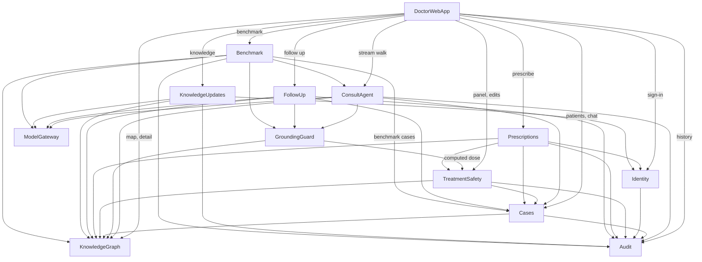

# Components — Brahma

Upstream: `requirements.md` (FR1–FR16, NFR1–NFR12, priority and cut order), `stories.md` (US1.1–US9.1), `team-practices.md` (local only, commit to main). Answers: `domain-design-questions.md` Q1–Q4. Decisions: `decisions.md` (ADR-001 – ADR-005).

Twelve building blocks plus the doctor web app. Databases, model providers, PDF rendering and the network are external dependencies, not components. Deployment shape is decided in Units Generation.

```yaml
components:
  - name: KnowledgeGraph
    summary: Stores packs, versions, nodes, edges, sources and comments, and answers searches and traversals over a pinned version.
    behaviour: >
      Loads a pack version and rejects it when any node lacks a source citation, naming the node (FR1.2).
      Search and traversal always run against one pinned pack version; published versions are immutable,
      a new version is created only through publish. Holds safety nodes (drug, interaction, allergy
      cross-reactivity) and response-criterion nodes like any other node type (FR1.1, FR1.6, FR2.3).
      Reference ranges are stored per sex (and age or pregnancy band) on metric nodes (FR1.4).
    responsibilities:
      - Pack and version storage, immutability of published versions
      - Node and edge search, traversal by edge condition
      - Reference-range lookup by patient attributes
      - Comments on nodes
    depends_on: []
    dependents:
      - component: GroundingGuard
        interaction: reads node fields to check claims
      - component: Cases
        interaction: reads the live version for pinning and the re-walk banner
      - component: ConsultAgent
        interaction: searches and traverses the graph during a walk
      - component: TreatmentSafety
        interaction: reads treatment, drug and safety nodes
      - component: Prescriptions
        interaction: reads sub-type, treatment, monitor and advice nodes for prescription fields
      - component: FollowUp
        interaction: reads response criteria and reference ranges
      - component: KnowledgeUpdates
        interaction: creates a new version on publish; reads nodes for before and after
      - component: Benchmark
        interaction: reads source lists and nodes for scoring
      - component: DoctorWebApp
        interaction: reads nodes for the map and detail panel
    external_dependencies:
      - name: Local database (for example SQLite)
        kind: database
        purpose: packs, versions, nodes, edges, sources, comments
    entities:
      - name: Pack
        identifier: packId
        attributes: [name, specialty, liveVersionNumber]
      - name: PackVersion
        identifier: packVersionId
        attributes: [packId, number, status, publishedAt, publishedBy, changeSummary]
        references:
          - entity: Profile
            owned_by: Identity
            relationship: each published version names the profile that published it
      - name: Node
        identifier: nodeId
        attributes: [packVersionId, type, label, content, structuredFields, sourceIds, plausibleRange, referenceRanges]
      - name: Edge
        identifier: edgeId
        attributes: [packVersionId, fromNodeId, toNodeId, relation, condition]
      - name: Source
        identifier: sourceId
        attributes: [title, year, section, url]
      - name: NodeComment
        identifier: commentId
        attributes: [nodeId, authorProfileId, text, createdAt]
        references:
          - entity: Profile
            owned_by: Identity
            relationship: each comment has one author profile

  - name: KnowledgeUpdates
    summary: Turns doctor suggestions, linked sources and scheduled source checks into proposed versions that a reviewer publishes or rejects.
    behaviour: >
      Every suggestion or model-drafted change becomes a Proposal against a base version and is never live
      until a reviewer profile publishes it (FR10.3, FR10.4). Source text from uploads and fetches is treated
      as data, never instructions; fetches allow http(s) only, refuse local and private addresses, and cap
      at 10 MB and 20 s. Drafted text repeating more than 25 consecutive source words is flagged and blocks
      publish (FR10.9). The scheduled checker re-fetches linked sources, compares content hashes, drafts a
      proposal when a source changed, and logs and skips unreachable sources (FR10.7). A failed submission
      keeps the form input (FR10.8).
    responsibilities:
      - Proposal lifecycle (proposed, published, rejected)
      - Source fetching, drafting through the model gateway, verbatim-copy flag
      - Scheduled source checks
    depends_on:
      - component: KnowledgeGraph
        interaction: read base version; create new version on publish
        style: sync
      - component: ModelGateway
        interaction: draft node changes from a source
        style: sync
      - component: Identity
        interaction: confirm the reviewer role before publish
        style: sync
      - component: Audit
        interaction: record proposals, publishes and rejections
        style: sync
    dependents:
      - component: DoctorWebApp
        interaction: Knowledge screen
    external_dependencies:
      - name: Public web (source URLs)
        kind: third-party-api
        purpose: fetching linked sources
      - name: Local scheduler
        kind: other
        purpose: daily source check
    entities:
      - name: Proposal
        identifier: proposalId
        attributes: [basePackVersionId, changes, sourcePassages, comment, status, copyFlags, proposerProfileId, reviewerProfileId, reviewerComment]
        references:
          - entity: PackVersion
            owned_by: KnowledgeGraph
            relationship: each proposal is made against one base version
          - entity: Profile
            owned_by: Identity
            relationship: each proposal has one proposer and at most one reviewer
      - name: LinkedSource
        identifier: linkedSourceId
        attributes: [url, nodeIds, lastContentHash, lastCheckedAt, lastStatus]
      - name: SourceCheckRun
        identifier: runId
        attributes: [startedAt, finishedAt, checked, changed, unreachable]

  - name: ModelGateway
    summary: One interface to the configured model provider (Meta Model API, Claude, free hosted Llama), with throttling, retries and call logging.
    behaviour: >
      The provider and model come from configuration only (FR14.1). Calls are throttled to the provider's
      rate limit and retried at most twice; a timeout, rate limit or bad key surfaces as a typed error to
      the caller (FR14.4). Every call is logged with provider, model, latency and token counts where
      available (NFR11). Keys come only from environment variables (NFR5).
    responsibilities:
      - Provider selection and calls
      - Throttling and bounded retries
      - Call logging
    depends_on: []
    dependents:
      - component: ConsultAgent
        interaction: extraction, walk narration, explanation
      - component: KnowledgeUpdates
        interaction: drafting node changes
      - component: FollowUp
        interaction: follow-up chat messages
      - component: Benchmark
        interaction: graph and plain runs
    external_dependencies:
      - name: Meta Model API
        kind: third-party-api
        purpose: submission model
      - name: Claude API
        kind: third-party-api
        purpose: development model
      - name: Free hosted Llama (for example Groq or OpenRouter)
        kind: third-party-api
        purpose: free development model
    entities:
      - name: ModelCallLog
        identifier: callId
        attributes: [provider, model, purpose, latencyMs, inputTokens, outputTokens, error, createdAt]

  - name: GroundingGuard
    summary: Checks every claim in a line of text against the fields of the nodes it cites, and returns pass or a rejection with reasons.
    behaviour: >
      Breaks a line into structured claims (diagnosis, test, drug, dose and unit, frequency, duration,
      threshold, tier), normalises units, and requires every claim to match a field of a cited node exactly
      (FR4.10). Computed doses (R-02): when a cited node gives a weight-based dose (for example 5 mg/kg),
      a claimed absolute dose passes only if it equals the result of TreatmentSafety's dose computation for
      that node and the patient's recorded weight, after the node's rounding rule; the caller passes the
      case ID as check context. If the weight is missing, the claim fails and the line is held back.
      Used before any answer line or "why" sentence reaches the screen (FR9.3), for follow-up
      verdicts (FR8.3), and for benchmark scoring of both runs (FR13.4). Stateless.
    responsibilities:
      - Claim extraction and normalisation
      - Claim-to-node matching, including computed weight-based doses
    depends_on:
      - component: KnowledgeGraph
        interaction: read cited node fields
        style: sync
      - component: TreatmentSafety
        interaction: compute the expected absolute dose from a mg/kg node and the patient's weight
        style: sync
    dependents:
      - component: ConsultAgent
        interaction: check answer lines and explanation sentences
      - component: FollowUp
        interaction: check verdict reasons
      - component: Benchmark
        interaction: score grounded share
    entities: []

  - name: Identity
    summary: Demo profiles, roles and disclaimer acceptance.
    behaviour: >
      Sign-in is picking one of three seeded profiles with no password (FR11.1). A profile's first sign-in
      requires the two-checkbox disclaimer; acceptance is stored once with date, disclaimer version and pack
      version, and is required again when either changes materially (FR11.2). Roles gate the reviewer actions.
    responsibilities:
      - Profiles and roles
      - Disclaimer acceptance
    depends_on:
      - component: Audit
        interaction: record acceptance
        style: sync
    dependents:
      - component: KnowledgeUpdates
        interaction: reviewer role check
      - component: Prescriptions
        interaction: doctor details for the prescription header
      - component: DoctorWebApp
        interaction: sign-in and first run
    entities:
      - name: Profile
        identifier: profileId
        attributes: [displayName, role, specialty, demoRegistration]
      - name: DisclaimerAcceptance
        identifier: acceptanceId
        attributes: [profileId, acceptedAt, disclaimerVersion, packVersion]
        references:
          - entity: Profile
            owned_by: Identity
            relationship: each acceptance belongs to one profile

  - name: Cases
    summary: Patients, cases, the chat thread, findings and patient details, version pinning and the one-tab lock.
    behaviour: >
      Creates cases with generated IDs labelled synthetic (FR12.2, FR15.2). Pins each case to the pack version
      its walk started on and reports when a newer version is live (FR1.7). Restores the chat, map state,
      card and unsubmitted form values on reopen (FR12.3). Holds a per-case lock so a second tab opens
      read-only; the lock is released when the holding tab closes (NFR7). Patient detail changes recompute
      reference ranges and weight-based doses through the graph (FR4.9).
    responsibilities:
      - Patient and case records, search
      - Chat thread and form state
      - Findings with validation state (FR4.11)
      - Version pin and tab lock
    depends_on:
      - component: KnowledgeGraph
        interaction: read live version and reference ranges
        style: sync
      - component: Audit
        interaction: record case creation and detail changes
        style: sync
    dependents:
      - component: ConsultAgent
        interaction: read and append chat, findings, pin
      - component: TreatmentSafety
        interaction: read patient allergies, weight, pregnancy status
      - component: Prescriptions
        interaction: read patient details and current medication
      - component: FollowUp
        interaction: read case and pin
      - component: Benchmark
        interaction: create benchmark cases
      - component: DoctorWebApp
        interaction: Patients screen, card, chat
    external_dependencies:
      - name: Local database (for example SQLite)
        kind: database
        purpose: patients, cases, messages, findings
    entities:
      - name: Patient
        identifier: patientId
        attributes: [syntheticName, age, sex, weightKg, pregnancyStatus, comorbidities, allergies, currentMedication]
      - name: Case
        identifier: caseId
        attributes: [patientId, ownerProfileId, pinnedPackVersionId, origin, benchmarkRunId, status, lockHolder, createdAt]
        references:
          - entity: Profile
            owned_by: Identity
            relationship: each case has one owner profile
          - entity: PackVersion
            owned_by: KnowledgeGraph
            relationship: each case is pinned to one pack version
      - name: Message
        identifier: messageId
        attributes: [caseId, author, kind, body, formKind, formState, createdAt]
      - name: Finding
        identifier: findingId
        attributes: [caseId, kind, name, value, unit, enteredValue, duration, validationState]

  - name: ConsultAgent
    summary: The grounded walk - extracts findings, walks the graph, asks for missing data, builds the cited pathway and the plain-language why, and handles explore and re-walk.
    behaviour: >
      Posts findings as a Confirm findings form before walking (FR4.1). Walks only by search and traversal on
      the case's pinned version (FR4.2). Every candidate answer line and why sentence passes GroundingGuard
      before it is streamed; failed lines are never sent and are counted as held back (FR4.3, FR4.10). Asks
      for missing tests with a Needs more data form and continues with partial results (FR4.4, FR4.11).
      Returns "No grounded answer" when nothing matches (FR4.5). Explore opens a side lane without changing
      the main plan (FR4.7). Free text during a walk is queued and offered as a re-walk afterwards (FR4.8).
      Writes the session record to Audit when the walk ends.
    responsibilities:
      - Finding extraction and confirmation
      - Graph walk and pathway assembly in fixed order
      - Needs-more-data, out-of-knowledge and explore behaviour
      - Plain-language why
    depends_on:
      - component: KnowledgeGraph
        interaction: search and traverse
        style: sync
      - component: ModelGateway
        interaction: extraction, narration, explanation text
        style: sync
      - component: GroundingGuard
        interaction: check each line before streaming
        style: sync
      - component: Cases
        interaction: read findings and pin; append messages and forms
        style: sync
      - component: Audit
        interaction: write session record and explore entries
        style: sync
    dependents:
      - component: DoctorWebApp
        interaction: the consultation workspace (streamed)
      - component: Benchmark
        interaction: runs the graph walk for each case
    entities:
      - name: Walk
        identifier: walkId
        attributes: [caseId, packVersionId, provider, model, state, pathNodeIds, answerSections, heldBackCount, startedAt, finishedAt]
        references:
          - entity: Case
            owned_by: Cases
            relationship: each walk belongs to one case
      - name: ExploreLane
        identifier: laneId
        attributes: [walkId, branchNodeId, testsAdded, status]

  - name: TreatmentSafety
    summary: Treatment detail, dose computation, safety checks and logged treatment edits.
    behaviour: >
      Computes mg/kg doses from the card's weight with the formula shown (FR6.2). Runs allergy, pregnancy,
      interaction and duplicate-class checks using only safety nodes; a drug or allergy with no safety node
      returns "Not checked", never "no conflict" (FR1.6, FR7.3). Edits keep the original suggestion and
      re-run checks; changing the drug resets route, dose and frequency to that drug's sourced suggestion
      (FR6.3, FR6.4). Every edit is written to Audit (FR6.5).
    responsibilities:
      - Dose computation
      - Safety checks
      - Treatment edits
    depends_on:
      - component: KnowledgeGraph
        interaction: read treatment, drug and safety nodes
        style: sync
      - component: Cases
        interaction: read patient attributes
        style: sync
      - component: Audit
        interaction: record edits
        style: sync
    dependents:
      - component: Prescriptions
        interaction: safety checks and edited values
      - component: GroundingGuard
        interaction: computed dose for claim checks
      - component: DoctorWebApp
        interaction: node panel and edit form
    entities:
      - name: TreatmentEdit
        identifier: editId
        attributes: [caseId, nodeId, originalValues, newValues, editorProfileId, checkResults, createdAt]
        references:
          - entity: Case
            owned_by: Cases
            relationship: each edit belongs to one case

  - name: Prescriptions
    summary: Drafts, checks, signs, voids and renders prescriptions (Could, cut first).
    behaviour: >
      Drafts lines from the answered plan, edits and current medication, each with a source kind (node, Card,
      Manual) in a generic international format (FR7.1, FR7.2). Blocks signing on allergy conflict, pregnancy
      contraindication or any placeholder; warnings and "Not checked" need an acknowledged tick (FR7.3,
      FR7.4). Signing stamps time, ID and pack version; the record is complete only once the PDF exists
      (FR7.6, FR7.8). Void keeps the original and opens a prefilled draft (FR7.7).
    responsibilities:
      - Draft, check, sign, void
      - PDF rendering with the demo watermark
    depends_on:
      - component: TreatmentSafety
        interaction: safety checks and edited values
        style: sync
      - component: Cases
        interaction: patient details and medication
        style: sync
      - component: KnowledgeGraph
        interaction: diagnosis, advice and follow-up nodes
        style: sync
      - component: Identity
        interaction: doctor details
        style: sync
      - component: Audit
        interaction: record sign, void and acknowledgements
        style: sync
    dependents:
      - component: DoctorWebApp
        interaction: prescription screen
    external_dependencies:
      - name: PDF renderer library
        kind: other
        purpose: prescription PDF
    entities:
      - name: Prescription
        identifier: prescriptionId
        attributes: [caseId, status, packVersionId, signedAt, signerProfileId, pdfPath, voidReason, replacesPrescriptionId]
        references:
          - entity: Case
            owned_by: Cases
            relationship: each prescription belongs to one case
      - name: PrescriptionLine
        identifier: lineId
        attributes: [prescriptionId, drug, form, route, dose, frequency, duration, instructions, sourceKind, sourceNodeId, included]

  - name: FollowUp
    summary: Follow-up visits, results, trends and grounded verdicts (Could, cut first).
    behaviour: >
      Records results per visit and plots them with cited target bands (FR8.2). Computes a verdict only from
      response-criterion nodes of the live version, checked through GroundingGuard; a measure with no
      criterion node gets no verdict (FR8.3, FR8.4). Records both the case's pinned version and the live
      version on each visit (FR1.7, FR8.5).
    responsibilities:
      - Visits and results
      - Trends and verdicts
    depends_on:
      - component: KnowledgeGraph
        interaction: response criteria and reference ranges
        style: sync
      - component: GroundingGuard
        interaction: check verdict reasons
        style: sync
      - component: Cases
        interaction: case, patient and pin
        style: sync
      - component: ModelGateway
        interaction: follow-up chat text
        style: sync
      - component: Audit
        interaction: record each visit
        style: sync
    dependents:
      - component: DoctorWebApp
        interaction: follow-up screen
    entities:
      - name: Visit
        identifier: visitId
        attributes: [caseId, number, visitDate, caseVersionId, liveVersionId, verdict, reasons]
        references:
          - entity: Case
            owned_by: Cases
            relationship: each visit belongs to one case
      - name: MeasureResult
        identifier: resultId
        attributes: [visitId, measureNodeId, value, unit]

  - name: Audit
    summary: The append-only record of sessions, edits, explores, prescriptions, visits, proposals and acceptances, with history, replay data and export.
    behaviour: >
      Has no update or delete operation; the database rejects UPDATE and DELETE on audit tables, and every
      write is one transaction (FR9.2, NFR7). Each entry records profile, pack version, provider and model.
      Serves history search and filters (FR9.4), replay data on the recorded version, and export to JSON and
      PDF (FR9.5).
    responsibilities:
      - Append-only entries and session records
      - History queries, replay data, export
    depends_on: []
    dependents:
      - component: Identity
        interaction: acceptance entries
      - component: Cases
        interaction: case entries
      - component: ConsultAgent
        interaction: session records and explores
      - component: TreatmentSafety
        interaction: edit entries
      - component: Prescriptions
        interaction: prescription entries
      - component: FollowUp
        interaction: visit entries
      - component: KnowledgeUpdates
        interaction: proposal entries
      - component: Benchmark
        interaction: run entries and benchmark session records
      - component: DoctorWebApp
        interaction: History screen
    external_dependencies:
      - name: Local database (for example SQLite)
        kind: database
        purpose: append-only audit tables
    entities:
      - name: AuditEntry
        identifier: entryId
        attributes: [caseId, sessionId, kind, payload, profileId, packVersionId, provider, model, createdAt]
      - name: SessionRecord
        identifier: sessionId
        attributes: [caseId, walkId, inputs, pathNodeIds, answer, sources, explanation, outcome, createdAt]
        references:
          - entity: Walk
            owned_by: ConsultAgent
            relationship: each session record captures one walk

  - name: Benchmark
    summary: Runs the 20 synthetic cases through the graph walk and the plain model, scores them, and reports pass or fail.
    behaviour: >
      Runs each case twice on the same model (FR13.3), scores grounded share with GroundingGuard and agreement
      with the expected pathway (FR13.4, FR13.5), and applies the two-part pass over the 16 IBD cases only
      (FR13.6). Throttles to the rate limit, saves each case result as it finishes, and resumes a stopped run
      (FR13.8). Records which provider, model and date produced each run (FR13.10).
      Benchmark walks (R-01): for each benchmark case and run, Benchmark creates a synthetic Case through
      Cases, marked origin "benchmark", owned by a system "Benchmark runner" profile and pinned to the pack
      version under test; ConsultAgent then walks it as usual. Its session records go to Audit tagged with
      the run ID, so every benchmark answer is auditable, but History and Patients exclude cases with origin
      "benchmark" by default (a "Show benchmark sessions" filter reveals them).
    responsibilities:
      - Case set with reviewed expected pathways
      - Runs, scoring, resume
      - Creating and tagging benchmark cases
    depends_on:
      - component: ConsultAgent
        interaction: graph run
        style: sync
      - component: Cases
        interaction: create a synthetic benchmark case pinned to the version under test
        style: sync
      - component: Audit
        interaction: record run start and finish; read the run's session records
        style: sync
      - component: GroundingGuard
        interaction: grounding score
        style: sync
      - component: ModelGateway
        interaction: plain run
        style: sync
      - component: KnowledgeGraph
        interaction: source list for the plain run
        style: sync
    dependents:
      - component: DoctorWebApp
        interaction: Benchmark screen
    entities:
      - name: BenchmarkCase
        identifier: benchmarkCaseId
        attributes: [specialty, inputs, expectedPathway, countsTowardPass, reviewedBy, reviewedAt]
      - name: BenchmarkRun
        identifier: runId
        attributes: [provider, model, startedAt, finishedAt, status]
      - name: CaseResult
        identifier: resultId
        attributes: [runId, benchmarkCaseId, mode, recommendations, groundedShare, agreement]

  - name: DoctorWebApp
    summary: The React interface - sign-in, Patients, the consultation workspace with chat and map, node panel, prescription, follow-up, History, Knowledge and Benchmark screens.
    behaviour: >
      Renders the handover screens with the refined-mockups annotations. Shows "Decision support, not
      diagnosis" and the pack version on every screen (FR15.1). Keeps chat and map selection in sync (FR5.3),
      renders streamed lines only after they arrive checked, and meets the five accessibility items (NFR3).
      Holds no business rules of its own.
    responsibilities:
      - Screens, states and accessibility
      - Chat and map selection sync
    depends_on:
      - component: Identity
        interaction: sign-in and first run
        style: sync
      - component: Cases
        interaction: patients, card, chat
        style: sync
      - component: ConsultAgent
        interaction: start and stream walks
        style: async
      - component: KnowledgeGraph
        interaction: map nodes and node detail
        style: sync
      - component: TreatmentSafety
        interaction: treatment panel and edits
        style: sync
      - component: Prescriptions
        interaction: prescription screen
        style: sync
      - component: FollowUp
        interaction: follow-up screen
        style: sync
      - component: Audit
        interaction: History screen
        style: sync
      - component: KnowledgeUpdates
        interaction: Knowledge screen
        style: sync
      - component: Benchmark
        interaction: Benchmark screen
        style: sync
    dependents: []
    entities: []
```

## Component Diagram



<!-- Text fallback: The doctor web app calls every user-facing block. ConsultAgent calls KnowledgeGraph, ModelGateway, GroundingGuard, Cases and Audit. GroundingGuard and Cases read KnowledgeGraph, and GroundingGuard asks TreatmentSafety for computed doses; Cases and Identity write to Audit. Benchmark also creates benchmark cases through Cases and writes run entries to Audit. TreatmentSafety reads KnowledgeGraph and Cases and writes Audit. Prescriptions calls TreatmentSafety, Cases, KnowledgeGraph, Identity and Audit. FollowUp calls KnowledgeGraph, GroundingGuard, Cases, ModelGateway and Audit. KnowledgeUpdates calls KnowledgeGraph, ModelGateway, Identity and Audit. Benchmark calls ConsultAgent, GroundingGuard, ModelGateway and KnowledgeGraph. KnowledgeGraph, ModelGateway and Audit call nothing. There are no cycles. -->

## Component Summary

| Component | Purpose | Depends On | Dependents | Entities Owned |
|---|---|---|---|---|
| KnowledgeGraph | Packs, versions, nodes, search and traversal | — | GroundingGuard, Cases, ConsultAgent, TreatmentSafety, Prescriptions, FollowUp, KnowledgeUpdates, Benchmark, DoctorWebApp | Pack, PackVersion, Node, Edge, Source, NodeComment |
| KnowledgeUpdates | Proposals, source fetch and drafting, scheduled checks | KnowledgeGraph, ModelGateway, Identity, Audit | DoctorWebApp | Proposal, LinkedSource, SourceCheckRun |
| ModelGateway | Swappable model provider, throttling, call log | — | ConsultAgent, KnowledgeUpdates, FollowUp, Benchmark | ModelCallLog |
| GroundingGuard | Claim check against cited nodes, including computed doses | KnowledgeGraph, TreatmentSafety | ConsultAgent, FollowUp, Benchmark | — |
| Identity | Profiles, roles, disclaimer | Audit | KnowledgeUpdates, Prescriptions, DoctorWebApp | Profile, DisclaimerAcceptance |
| Cases | Patients, cases, chat, findings, pin, tab lock | KnowledgeGraph, Audit | ConsultAgent, TreatmentSafety, Prescriptions, FollowUp, Benchmark, DoctorWebApp | Patient, Case, Message, Finding |
| ConsultAgent | The grounded walk and the why | KnowledgeGraph, ModelGateway, GroundingGuard, Cases, Audit | DoctorWebApp, Benchmark | Walk, ExploreLane |
| TreatmentSafety | Doses, safety checks, edits | KnowledgeGraph, Cases, Audit | Prescriptions, GroundingGuard, DoctorWebApp | TreatmentEdit |
| Prescriptions | Draft, check, sign, void, PDF | TreatmentSafety, Cases, KnowledgeGraph, Identity, Audit | DoctorWebApp | Prescription, PrescriptionLine |
| FollowUp | Visits, trends, verdicts | KnowledgeGraph, GroundingGuard, Cases, ModelGateway, Audit | DoctorWebApp | Visit, MeasureResult |
| Audit | Append-only record, history, export | — | Identity, Cases, ConsultAgent, TreatmentSafety, Prescriptions, FollowUp, KnowledgeUpdates, Benchmark, DoctorWebApp | AuditEntry, SessionRecord |
| Benchmark | Runs, scoring, pass or fail | ConsultAgent, GroundingGuard, ModelGateway, KnowledgeGraph, Cases, Audit | DoctorWebApp | BenchmarkCase, BenchmarkRun, CaseResult |
| DoctorWebApp | All screens | Identity, Cases, ConsultAgent, KnowledgeGraph, TreatmentSafety, Prescriptions, FollowUp, Audit, KnowledgeUpdates, Benchmark | — | — |

## Entity Ownership

| Entity | Owning Component | Identifier | Attributes | References |
|---|---|---|---|---|
| Pack | KnowledgeGraph | packId | name, specialty, liveVersionNumber | — |
| PackVersion | KnowledgeGraph | packVersionId | packId, number, status, publishedAt, publishedBy, changeSummary | Profile (Identity) |
| Node | KnowledgeGraph | nodeId | packVersionId, type, label, content, structuredFields, sourceIds, plausibleRange, referenceRanges | — |
| Edge | KnowledgeGraph | edgeId | packVersionId, fromNodeId, toNodeId, relation, condition | — |
| Source | KnowledgeGraph | sourceId | title, year, section, url | — |
| NodeComment | KnowledgeGraph | commentId | nodeId, authorProfileId, text, createdAt | Profile (Identity) |
| Proposal | KnowledgeUpdates | proposalId | basePackVersionId, changes, sourcePassages, comment, status, copyFlags, proposerProfileId, reviewerProfileId, reviewerComment | PackVersion (KnowledgeGraph), Profile (Identity) |
| LinkedSource | KnowledgeUpdates | linkedSourceId | url, nodeIds, lastContentHash, lastCheckedAt, lastStatus | — |
| SourceCheckRun | KnowledgeUpdates | runId | startedAt, finishedAt, checked, changed, unreachable | — |
| ModelCallLog | ModelGateway | callId | provider, model, purpose, latencyMs, inputTokens, outputTokens, error, createdAt | — |
| Profile | Identity | profileId | displayName, role, specialty, demoRegistration | — |
| DisclaimerAcceptance | Identity | acceptanceId | profileId, acceptedAt, disclaimerVersion, packVersion | Profile (Identity) |
| Patient | Cases | patientId | syntheticName, age, sex, weightKg, pregnancyStatus, comorbidities, allergies, currentMedication | — |
| Case | Cases | caseId | patientId, ownerProfileId, pinnedPackVersionId, origin, benchmarkRunId, status, lockHolder, createdAt | Profile (Identity), PackVersion (KnowledgeGraph) |
| Message | Cases | messageId | caseId, author, kind, body, formKind, formState, createdAt | — |
| Finding | Cases | findingId | caseId, kind, name, value, unit, enteredValue, duration, validationState | — |
| Walk | ConsultAgent | walkId | caseId, packVersionId, provider, model, state, pathNodeIds, answerSections, heldBackCount, startedAt, finishedAt | Case (Cases) |
| ExploreLane | ConsultAgent | laneId | walkId, branchNodeId, testsAdded, status | — |
| TreatmentEdit | TreatmentSafety | editId | caseId, nodeId, originalValues, newValues, editorProfileId, checkResults, createdAt | Case (Cases) |
| Prescription | Prescriptions | prescriptionId | caseId, status, packVersionId, signedAt, signerProfileId, pdfPath, voidReason, replacesPrescriptionId | Case (Cases) |
| PrescriptionLine | Prescriptions | lineId | prescriptionId, drug, form, route, dose, frequency, duration, instructions, sourceKind, sourceNodeId, included | — |
| Visit | FollowUp | visitId | caseId, number, visitDate, caseVersionId, liveVersionId, verdict, reasons | Case (Cases) |
| MeasureResult | FollowUp | resultId | visitId, measureNodeId, value, unit | — |
| AuditEntry | Audit | entryId | caseId, sessionId, kind, payload, profileId, packVersionId, provider, model, createdAt | — |
| SessionRecord | Audit | sessionId | caseId, walkId, inputs, pathNodeIds, answer, sources, explanation, outcome, createdAt | Walk (ConsultAgent) |
| BenchmarkCase | Benchmark | benchmarkCaseId | specialty, inputs, expectedPathway, countsTowardPass, reviewedBy, reviewedAt | — |
| BenchmarkRun | Benchmark | runId | provider, model, startedAt, finishedAt, status | — |
| CaseResult | Benchmark | resultId | runId, benchmarkCaseId, mode, recommendations, groundedShare, agreement | — |

## External Dependencies

| Component | Dependency | Kind | Purpose |
|---|---|---|---|
| KnowledgeGraph | Local database | database | Packs, versions, nodes, edges, sources |
| KnowledgeUpdates | Public web | third-party-api | Fetching linked sources |
| KnowledgeUpdates | Local scheduler | other | Daily source check |
| ModelGateway | Meta Model API | third-party-api | Submission model |
| ModelGateway | Claude API | third-party-api | Development model |
| ModelGateway | Free hosted Llama | third-party-api | Free development model |
| Cases | Local database | database | Patients, cases, chat |
| Prescriptions | PDF renderer library | other | Prescription PDF |
| Audit | Local database | database | Append-only audit tables |

## Rationale

| Component | Why it is its own block |
|---|---|
| KnowledgeGraph | Distinct data ownership: the versioned clinical content every other block reads; changes only through publish |
| KnowledgeUpdates | Distinct lifecycle (proposal → review → publish) and the only block that handles untrusted source text |
| ModelGateway | Distinct change rate: providers switch by configuration and Meta access arrives late (ADR-003) |
| GroundingGuard | Distinct concern: the core promise, shared by four callers and tested on its own (ADR-002) |
| Identity | Distinct concern: who is acting and whether they accepted the disclaimer |
| Cases | Distinct data ownership: the live, changing case record (ADR-004) |
| ConsultAgent | Distinct concern: the walk logic, the largest and most-tested block |
| TreatmentSafety | Distinct concern: dose and safety rules, needed by Must stories even if prescriptions are cut |
| Prescriptions | Distinct lifecycle (draft → signed → void) and cut-first priority (ADR-001) |
| FollowUp | Distinct lifecycle (visits over time) and cut-first priority (ADR-001) |
| Audit | Distinct data ownership with an append-only rule no other block may weaken (ADR-004) |
| Benchmark | Distinct concern: judges' proof, run on demand, reuses the walk and the guard |
| DoctorWebApp | Distinct technology and change rate: the React screens from your design handover |

**Alternatives rejected:** five coarse blocks (knowledge, agent, audit, app, update layer). It would put cut-first prescription and follow-up code inside the agent and app blocks, and hide the claim check inside the agent where the benchmark couldn't reuse it (ADR-001, ADR-002).
