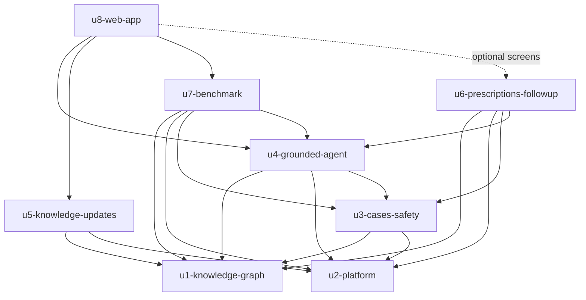

# Unit Dependencies — Brahma

Upstream: `unit-of-work.md`, `components.md` (component dependencies), `decisions.md` (ADR-001, ADR-005). This describes topology only; the build order is chosen in Delivery Planning.

## Dependency DAG

```yaml
units:
  - name: u1-knowledge-graph
    kind: library
    depends_on: []
  - name: u2-platform
    kind: library
    depends_on: []
  - name: u3-cases-safety
    kind: library
    depends_on: [u1-knowledge-graph, u2-platform]
  - name: u4-grounded-agent
    kind: service
    depends_on: [u1-knowledge-graph, u2-platform, u3-cases-safety]
  - name: u5-knowledge-updates
    kind: library
    depends_on: [u1-knowledge-graph, u2-platform]
  - name: u6-prescriptions-followup
    kind: library
    depends_on: [u1-knowledge-graph, u2-platform, u3-cases-safety, u4-grounded-agent]
  - name: u7-benchmark
    kind: library
    depends_on: [u1-knowledge-graph, u2-platform, u3-cases-safety, u4-grounded-agent]
  - name: u8-web-app
    kind: ui
    depends_on: [u4-grounded-agent, u5-knowledge-updates, u7-benchmark]
```

U8 has no hard dependency on u6-prescriptions-followup (R-01). The prescription and follow-up screens are an optional feature module in U8. They show only when the backend reports U6 mounted, and U8's own tests and done line pass without U6. If U6 is built, its screens are wired in and tested as part of U6's done line, against U8's shell.



<!-- Text fallback: U1 and U2 depend on nothing. U3 depends on U1 and U2. U4 depends on U1, U2 and U3. U5 depends on U1 and U2. U6 and U7 each depend on U1, U2, U3 and U4. U8 depends on U4, U5 and U7, and shows U6's screens only when U6 is present. There are no cycles. -->

## Why each edge exists

| Unit | Depends on | Because |
|---|---|---|
| u3-cases-safety | u1, u2 | Version pin and reference ranges read the graph; case and edit entries go to the audit |
| u4-grounded-agent | u1, u2, u3 | The walk reads the graph, calls the model gateway, writes sessions to the audit, reads findings and computes doses through U3 |
| u5-knowledge-updates | u1, u2 | Publishing creates a graph version; drafting calls the gateway; the reviewer role and audit come from U2 |
| u6-prescriptions-followup | u1, u2, u3, u4 | Prescriptions use U3's safety checks; follow-up verdicts use U4's grounding guard |
| u7-benchmark | u1, u2, u3, u4 | Runs the U4 walk on U3 benchmark cases, scores with U4's grounding guard, reads U2 audit |
| u8-web-app | u4, u5, u7 | Calls the backend HTTP API those units expose (U1–U3 are reached through U4's server). U6 screens are optional and shown only when U6 is mounted (R-01) |

## Integration Points

| From | To | How |
|---|---|---|
| Backend units | Each other | In-process calls through each unit's public module interface; no unit reads another unit's tables (Q4) |
| u8-web-app | Backend | HTTP JSON API on the local server; the walk is a streamed response of checked lines (ADR-005) |
| u5, u6, u7 | u4 server | Each exposes a router module; U4 mounts the ones named in configuration, so a cut unit is simply not listed |
| All backend units | Shared SQLite file | Each unit owns its own tables |

## Parallel Development

- **U1 and U2** have no dependency between them.
- **U5** depends only on U1 and U2, so it can be built alongside U3 and U4.
- **U6 and U7** both need only U1 to U4, so they can be built side by side.
- **U8** needs U4, U5 and U7, but its screens can be built against stubbed API responses before those units finish. Its tests only need to pass against the real API once they exist.
- **U6** is optional for U8.

## Walking Skeleton

Off for this project (`team-practices.md`, Walking Skeleton). No unit is shaped as a first end-to-end slice.
